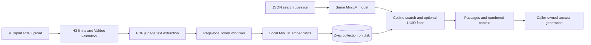

# ZCatalog

ZCatalog retrieves passages from PDF books and documents using Node.js, Nitro v3, local text embeddings, and Zvec. Upload a PDF, search by meaning, and receive source passages with physical PDF page numbers and a numbered context string for an answer model.

The service implements the retrieval part of RAG. It does not generate answers, perform OCR, or run a separate database server.

## Contents

- [Setup](#setup)
- [Tools and dependencies](#tools-and-dependencies)
- [Usage and API](#usage-and-api)
- [Architecture and implementation](#architecture-and-implementation)
- [Logging](#logging)
- [Testing and development](#testing-and-development)
- [Deployment and operations](#deployment-and-operations)
- [Troubleshooting](#troubleshooting)

## Setup

Use the versions pinned in `package.json`: Node.js **26.0.0** and pnpm **12.15.0**. If pnpm is not installed, install it with `npm install --global pnpm@12.15.0` after installing Node. Run commands from the repository root.

```bash
pnpm install
pnpm dev
```

The API is available at `http://localhost:3000`. Check that the handler is reachable:

```bash
curl --fail-with-body http://localhost:3000/api
```

This returns `{"message":"Hello from API!"}`. It does not check model availability or database health.

No API key, `.env` file, or external database service is required. The first valid upload or search downloads `Xenova/all-MiniLM-L6-v2` and its tokenizer from Hugging Face. Allow internet access for this first use and expect extra startup latency. The model is intended for English text.

Zvec, ONNX Runtime, and PDF.js's canvas dependency use native binaries. Installation must succeed for the machine's OS and CPU architecture. `pnpm-workspace.yaml` permits the required Zvec and ONNX build scripts; it also permits protobufjs and the existing Git-hook tooling.

The process needs a writable `.data` directory and a writable model cache. Transformers.js uses a `.cache` directory relative to its installed library by default; this is separate from the repository's `.data` directory. The application does not override the cache location.

## Tools and dependencies

Exact installed versions are recorded in `pnpm-lock.yaml`.

| Tool                        | Role                                                                                                                                              |
| --------------------------- | ------------------------------------------------------------------------------------------------------------------------------------------------- |
| Node.js and TypeScript      | Server runtime and typed application code. Node's `Array.fromAsync` is used for sequential async processing.                                      |
| Nitro v3 and H3             | Filesystem routes, HTTP requests/responses, body limits, lifecycle hooks, and generated OpenAPI documentation. H3 is imported through `nitro/h3`. |
| Rolldown                    | Nitro's production server bundler.                                                                                                                |
| `pdfjs-dist`                | Extracts text from PDF pages. It does not perform OCR.                                                                                            |
| `@napi-rs/canvas`           | Native dependency used by PDF.js's Node runtime. It is retained in production output.                                                             |
| `@huggingface/transformers` | Runs the local, quantized MiniLM embedding model through ONNX Runtime.                                                                            |
| `@zvec/zvec`                | Embedded, persistent vector collection with exact cosine search.                                                                                  |
| `valibot`                   | Validates upload titles, search requests, and stored passage fields when reading query results.                                                   |
| `uuid`                      | Generates UUID v7 book and passage IDs.                                                                                                           |
| `evlog`                     | Emits structured request events, errors, timing, and operation context.                                                                           |
| Vitest                      | Runs extraction, storage, route, and opt-in semantic tests.                                                                                       |
| Oxfmt, Oxlint, TypeScript   | Formatting, linting, and static type checks.                                                                                                      |
| Lefthook                    | Runs staged formatting and lint checks before commits.                                                                                            |
| genbumppush                 | Existing conventional-commit release tooling, invoked with `pnpm release`; it is not needed to run the API.                                       |

Vendored instructions under `.agents/skills` and `skills-lock.json` support development agents. They are not application dependencies or runtime documentation.

## Usage and API

### Upload a PDF

```bash
curl --fail-with-body http://localhost:3000/api/books \
  --form 'title=My book' \
  --form 'file=@/absolute/path/book.pdf;type=application/pdf'
```

`POST /api/books` accepts `multipart/form-data`. Let curl set the multipart boundary; do not manually set the request's `Content-Type` when using `--form`.

| Field          | Requirement                                                                                          |
| -------------- | ---------------------------------------------------------------------------------------------------- |
| `file`         | Required file part. Its bytes must start with `%PDF-`, and PDF.js must be able to extract text.      |
| `title`        | Required string, trimmed before validation and storage. Between 1 and 300 characters after trimming. |
| Entire request | At most 250 MiB (262,144,000 bytes), including multipart overhead.                                   |

Ingestion runs to completion within the request. A successful response is HTTP **201**. This response shape is illustrative; counts depend on the PDF:

```json
{
  "bookId": "01900000-0000-7000-8000-000000000001",
  "title": "My book",
  "pages": 7,
  "chunks": 28
}
```

`pages` counts every physical PDF page, including pages without text. `chunks` counts the indexed passages. Valid PDFs containing no extractable text return `PDF_TEXT_REQUIRED`. A zero-byte file fails the signature check with `PDF_FILE_INVALID`. Scanned documents need OCR before uploading; password-protected documents are not supported.

Every upload generates a new UUID v7 book ID and UUID v7 passage IDs. Uploading the same PDF again creates another book; there is no deduplication or upload-by-existing-ID API. The response's book ID is needed to search only that upload.

### Search documents

```bash
curl --fail-with-body http://localhost:3000/api/search \
  --json '{"query":"How is extraction accuracy evaluated?","topK":5}'
```

To search one uploaded document, copy its returned UUID into `bookId`:

```bash
curl --fail-with-body http://localhost:3000/api/search \
  --json '{
    "query":"How is extraction accuracy evaluated?",
    "topK":5,
    "bookId":"01900000-0000-7000-8000-000000000001"
  }'
```

The example UUID must be replaced with an actual upload ID.

| JSON field     | Requirement                                                                                                                     |
| -------------- | ------------------------------------------------------------------------------------------------------------------------------- |
| `query`        | Required string. Trimmed, non-empty, and at most 2,000 characters. It must also fit 256 model tokens, including special tokens. |
| `topK`         | Optional integer from 1 through 20; defaults to 5.                                                                              |
| `bookId`       | Optional valid UUID. Generated IDs use version 7, while request validation accepts UUIDs generally.                             |
| Entire request | At most 16 KiB (16,384 bytes).                                                                                                  |

The service ignores unrecognized JSON properties. It returns HTTP **200** with this shape; the passage and score below are illustrative:

```json
{
  "query": "How is extraction accuracy evaluated?",
  "passages": [
    {
      "id": "01900000-0000-7000-8000-000000000002",
      "score": 0.72,
      "bookId": "01900000-0000-7000-8000-000000000001",
      "title": "My book",
      "page": 3,
      "chunk": 0,
      "text": "example passage text"
    }
  ],
  "context": "[1] My book, PDF page 3\nexample passage text"
}
```

Results follow Zvec's relevance order. `score` is the raw cosine similarity, not an answer-confidence probability. No minimum relevance threshold is applied. Fewer than `topK` passages can be returned. An empty collection or a UUID with no matching passages returns `"passages": []` and `"context": ""`, rather than a 404.

Page numbers start at 1 and refer to the PDF file, which may differ from printed page labels. Chunk numbers start at 0 within each page. Passage text is decoded from model tokens, so capitalization, spacing, and typography can differ from the original PDF. Overlapping chunks may repeat text.

### Use results in RAG

Send the user's question and returned `context` to your chosen answer model. Instruct it to cite numbered sources such as `[1]`, treat retrieved content as untrusted data, and say when the evidence is insufficient. The API does not select an answer model, construct an answer prompt, or verify generated claims. Similarity search can return irrelevant passages when the collection lacks an answer.

### Errors

Handled application errors put the stable code in the JSON response's `message`. Infrastructure failures can return a generic message; inspect server logs for details. Nitro may add other fields and development diagnostics. For example:

```json
{
  "url": "/api/search",
  "statusCode": 400,
  "message": "SEARCH_REQUEST_INVALID",
  "error": true
}
```

| HTTP status | Code or condition                            | Meaning                                                                                                                                                                       |
| ----------- | -------------------------------------------- | ----------------------------------------------------------------------------------------------------------------------------------------------------------------------------- |
| 400         | `PDF_FILE_REQUIRED`                          | Upload has no file part.                                                                                                                                                      |
| 400         | `PDF_TITLE_REQUIRED`                         | Upload title is absent or empty.                                                                                                                                              |
| 400         | `BOOK_TITLE_INVALID`                         | Title has the wrong type, is whitespace-only, or exceeds 300 characters after trimming.                                                                                       |
| 400         | `PDF_FILE_INVALID`                           | File does not start with the expected PDF signature.                                                                                                                          |
| 400         | `SEARCH_REQUEST_INVALID`                     | Search fields fail validation.                                                                                                                                                |
| 400         | `SEARCH_QUERY_TOO_LONG`                      | Query exceeds the model's token budget.                                                                                                                                       |
| 400         | Malformed JSON                               | H3 could not parse the search body; this uses a framework message.                                                                                                            |
| 413         | Body too large                               | Upload or search request exceeds its byte limit; this uses a framework message.                                                                                               |
| 422         | `PDF_EXTRACTION_FAILED`                      | PDF.js could not parse or extract the document, including unsupported protected PDFs.                                                                                         |
| 422         | `PDF_TEXT_REQUIRED`                          | A valid PDF has no extractable text.                                                                                                                                          |
| 500         | Infrastructure or unexpected parsing failure | Model download/inference, native binding, storage, or malformed multipart parsing failed. `BOOK_INDEX_WRITE_FAILED` identifies a rejected write status in server diagnostics. |

Malformed multipart requests and incorrect upload content types currently have no dedicated application error mapping and can return 500. There are no automatic retries or transaction rollback on failed ingestion.

### OpenAPI and HTTP request files

Nitro generates the OpenAPI 3.1 specification from route-level `defineRouteMeta` declarations:

- `http://localhost:3000/_openapi.json`: JSON specification, including multipart upload, search fields, response schemas, and error statuses.
- `http://localhost:3000/_scalar`: Scalar API UI.
- `http://localhost:3000/_swagger`: Swagger UI.

These endpoints are enabled in development and production by `nitro.config.ts`. They have no access controls in this application. Shared schemas are registered through the API availability route's `$global.components.schemas` metadata; upload and search routes reference them. Metadata documents the API, while Valibot and handler code enforce its runtime constraints.

[tests/http/books.http](tests/http/books.http) contains runnable requests for the bundled article, search, and validation errors. Open it with the VS Code REST Client extension, set `@baseUrl` if needed, and run the named `uploadBook` request before the filtered search. The file uses that request's response to populate `bookId`. Its PDF path is relative to the `.http` file. The extension is optional; curl works independently.

## Architecture and implementation



### Code map

| File                                     | Responsibility                                                                                                |
| ---------------------------------------- | ------------------------------------------------------------------------------------------------------------- |
| `server/routes/api/index.ts`             | Static availability response and shared OpenAPI schemas.                                                      |
| `server/routes/api/books/index.post.ts`  | Multipart boundary validation, upload limits, ingestion response, OpenAPI operation, and request log context. |
| `server/routes/api/search/index.post.ts` | Search boundary validation, limits, OpenAPI operation, and request log context.                               |
| `server/utils/pdf.ts`                    | Page text extraction, PDF resource cleanup, and token windows.                                                |
| `server/utils/embeddings.ts`             | Lazy model loading, cached initialization promise, and normalized embeddings.                                 |
| `server/utils/books.ts`                  | Coordinates ingestion and retrieval; builds numbered context.                                                 |
| `server/stores/useBookStore.ts`          | Collection schema, lazy shared connection, batched writes, and filtered queries.                              |
| `server/plugins/books.ts`                | Closes the shared collection during Nitro shutdown.                                                           |
| `nitro.config.ts`                        | Routing, aliases, OpenAPI, evlog integration, and native dependency packaging.                                |
| `evlog.config.ts`                        | Logging service name and redaction settings.                                                                  |

### Ingestion

1. The handler limits the multipart body, validates the title and PDF signature, and obtains the collection.
2. PDF.js visits pages in physical order. Text items are joined with spaces or line breaks. Empty pages retain their page number but produce no passages. PDF.js resources are destroyed in a `finally` block.
3. The MiniLM tokenizer splits each page into windows of at most **200 tokens** with **40 tokens of overlap**. Windows never cross page boundaries. Tokenization happens without special tokens; the embedding pipeline adds its own special tokens.
4. Each window is decoded to passage text and embedded using `Xenova/all-MiniLM-L6-v2`, `dtype: 'q8'`, mean pooling, and normalization. The quantized model runs locally; stored vectors are **384-dimensional FP32** arrays.
5. The service collects all embedded passages in memory, then upserts them in batches of at most **1,024 records**, checking every returned write status. Successful completion returns book metadata.

`Array.fromAsync` processes pages and embeddings sequentially within an upload. This avoids launching thousands of model inferences at once. Multiple incoming requests can still overlap; there is no job queue or global ingestion concurrency limit. Upload bytes, page text, and prepared vectors can coexist in memory.

### Collection and retrieval

The `book_passages` collection stores one record per passage:

| Field              | Zvec type or representation                   |
| ------------------ | --------------------------------------------- |
| Record `id`        | UUID v7 string.                               |
| `bookId`           | String, generated as UUID v7 once per upload. |
| `title`, `text`    | Strings.                                      |
| `page`, `chunk`    | INT32 values.                                 |
| Vector `embedding` | VECTOR_FP32, dimension 384.                   |

The embedding field uses a **FLAT** index with the **COSINE** metric. This is exact search, not approximate HNSW search. Search work grows with the number of stored vectors; there is no reranker, keyword index, hybrid search, or scalar index on `bookId` in the current schema.

Search validates the question's token budget, embeds it with the same model, and queries Zvec for up to `topK` passages. When supplied, the UUID is applied as a scalar filter. Stored passage fields are validated when results are read. The context joins each result as `[number] title, PDF page N`, followed by its text.

`useBookStore().get()` lazily opens one module-scoped collection, creating it if absent. `open(path)` is also available for isolated tests; callers opening collections directly must close those handles. The shutdown plugin owns cleanup of the shared application handle. There are no public book listing, deletion, editing, download, or reindexing endpoints.

## Logging

The `evlog/nitro/v3` module is registered once in `nitro.config.ts`, and it loads `evlog.config.ts`. The configuration names the service `zcatalog` and enables built-in redaction. Nitro hooks attach a request logger and emit request events with method, path, request ID, duration, HTTP status, and captured errors. Handlers add context through `useLogger(event)`; they do not manually emit a second completion event.

| Operation | Added context                                                                                                                                                                                                       |
| --------- | ------------------------------------------------------------------------------------------------------------------------------------------------------------------------------------------------------------------- |
| Upload    | `action: books.ingest`, stage (`validate`, `ingest`, `complete`), file byte count, generated book ID, page/chunk counts, and success outcome.                                                                       |
| Search    | `action: books.search`, stage (`validate`, `search`, `complete`), query character count, requested result count, whether a UUID filter was supplied, optional book ID, returned passage count, and success outcome. |

Stages identify the phase reached before a failure; they are not per-step timing measurements. Successful logs set `outcome: success`. Thrown errors are captured by the integration with the last recorded stage. The route context deliberately omits PDF bytes, extracted passages, query text, titles, and filenames. Built-in redaction is an additional safeguard, not a substitute for choosing safe fields.

Logs go to process output: readable formatting in development and JSON in production. There is no configured file drain, hosted logging backend, retention policy, or `.evlog/logs` output. Capture stdout/stderr through your process manager or hosting platform. Request IDs appear in logs; the application does not add a custom request-ID response header. Logging configuration changes require restarting the process or rebuilding the production output.

## Testing and development

```bash
pnpm check                         # formatting, lint, and type checks
pnpm test                          # regular tests; semantic test skipped
RUN_SEMANTIC_TEST=1 pnpm test       # includes actual local embeddings
pnpm test:watch                    # watch mode
pnpm build                        # produce .output
```

The fixture is the seven-page AI document extraction article in `public/assets`. Tests cover token overlap and tail preservation, PDF extraction and physical page numbering, invalid PDFs, Zvec ranking and UUID filtering, repeated upserts, persistence after reopening, multipart parsing after body limiting, and safe upload/search log context. The opt-in semantic test indexes the article twice, checks distinct UUID v7 book IDs, and verifies retrieval of the evaluation methodology on PDF page 3. It needs access to the model download or an existing cache. Temporary test collections are closed and removed in `finally` blocks.

The normal test suite does not prove that every real document will retrieve relevant results, and it does not measure throughput or deployment memory limits. Route metadata changes must also be checked against the generated `/_openapi.json`, since unit tests do not run Nitro's metadata extraction step.

To build and run a production server:

```bash
pnpm build
pnpm start
```

`pnpm dev` watches source changes. `pnpm preview` serves the existing production build, while `pnpm start` runs its Node entry point directly. Both require a build and must restart after rebuilding to load new code. To choose a different port, use `PORT=3001 pnpm start`.

## Deployment and operations

### Docker

Install Docker with Compose v2 and start its daemon, then run:

```bash
pnpm docker:up
curl --fail-with-body http://localhost:3000/api
```

The multi-stage image builds Linux native dependencies inside Docker with the pinned Node.js and pnpm versions. Before copying Nitro's production output into the runtime, it removes ONNX binaries for other CPU architectures and the unused standalone ONNX browser runtime package. Transformers.js bundles its browser adapter and uses native ONNX for this service's CPU inference. The runtime runs as the `node` user. The health check confirms HTTP availability; it does not load the embedding model or check the collection.

Compose binds the API to localhost on port 3000. Use `PORT=3001 pnpm docker:up` to change the host port. Put a reverse proxy in front of the API for remote access and TLS. Run one container per collection; do not scale this service against the same volume.

| Command               | Purpose                                                                         |
| --------------------- | ------------------------------------------------------------------------------- |
| `pnpm docker:build`   | Build the production image.                                                     |
| `pnpm docker:test`    | Test API metadata, PDF ingestion, and semantic search in an isolated container. |
| `pnpm docker:up`      | Build, start in the background, and wait for health.                            |
| `pnpm docker:down`    | Remove containers and network, preserving volumes.                              |
| `pnpm docker:logs`    | Follow API logs.                                                                |
| `pnpm docker:ps`      | Show service status.                                                            |
| `pnpm docker:restart` | Restart the existing container without rebuilding.                              |
| `pnpm docker:config`  | Validate the Compose configuration.                                             |

The `data` volume stores the Zvec collection. The `models` volume persists Transformers.js's default model cache. Both survive container rebuilds and `docker:down`. The first upload or search still needs outbound access to Hugging Face. `docker compose down --volumes` permanently deletes both volumes, including indexed documents. Stop the service before backing up the data volume.

Compose allows 35 seconds for shutdown so Nitro can finish its default 30-second graceful shutdown window. Source edits require `pnpm docker:up` to rebuild and recreate the container.

Container logs rotate at 10 MB per file with at most three files, using Docker's `local` logging driver. The image smoke test requires a running Docker daemon and outbound Hugging Face access. Run `pnpm docker:build` followed by `pnpm docker:test`; the test creates an isolated container with an empty collection and model cache, then removes that container in its cleanup step. It does not use the Compose data volumes.

### Release validation

`pnpm release` runs checks and unit tests before genbumppush bumps the version and pushes the release commit and tag. The GitHub Actions release workflow checks out the event's exact commit, verifies that the tag matches the package version, runs checks and unit tests, and builds the application with `pnpm build`.

Docker builds and smoke tests run locally with `pnpm docker:build` and `pnpm docker:test`. Local builds use the builder's architecture. CI does not run Docker operations or publish images.

Preview version changes with `pnpm release --dry-run`. To retry release validation, rerun the Release workflow for the original tag event. The rerun checks out the original event commit and rebuilds and tests it. Preserve published Git tags instead of moving them.

### Files and persistence

- `.data/books-minilm-l6-v2` contains the collection relative to the process's working directory. Start from a consistent directory and mount persistent writable storage there.
- Uploaded original PDFs are parsed in memory and are not saved to disk by the application. Retain source documents separately if you need downloads or future reindexing.
- The embedding model cache belongs to Transformers.js and is separate from `.data`. Production `.output` does not include warmed model weights automatically. Warm the actual deployed build before restricting network access, and preserve a writable cache for restarts.
- `public/` is served as static content and copied into builds. The bundled test article is publicly accessible. Keep private documents out of `public/`; posting a PDF to the ingestion API does not automatically place it there.

### Process model and capacity

Run one Node process per collection. Zvec holds a collection lock; multiple workers or replicas must not open the same collection directory. Independent replicas with separate directories have separate data. This application is not configured for shared distributed storage or horizontal scaling.

Build for the deployment target's OS and architecture. Nitro externalizes Zvec, Transformers.js, and PDF.js, and traces their packages plus canvas so native bindings, ONNX assets, and PDF.js workers remain available in `.output`. Deploy the whole output directory. A successful build does not guarantee that copied native binaries will load on a different platform.

Configure reverse-proxy body limits to allow the multipart request limit and set timeouts for complete synchronous ingestion, especially on first use. Memory requirements can exceed the uploaded file's size. There is no global request queue, cancellation workflow, or streaming ingestion progress endpoint.

### Backup and failure recovery

Stop the server cleanly before copying the complete `.data/books-minilm-l6-v2` directory for a consistent offline backup. Restore the whole collection directory with the server stopped, then restart with compatible native dependencies and the same embedding configuration. The application has no online snapshot or restore API.

Ingestion prepares embeddings before writing, but the batch writes are not transactional. A write failure can leave a partial book. Retrying creates a new book ID and does not remove the partial records. There is no per-book cleanup endpoint; use a known-good backup or an explicitly planned maintenance operation if cleanup is required.

Changing the embedding model, dimensions, pooling, normalization, or chunking configuration requires re-extracting and re-embedding retained source PDFs. Do not mix incompatible embeddings in the existing collection. The model and collection path are currently hardcoded in `server/utils/embeddings.ts` and `server/stores/useBookStore.ts`; there is no model-selection environment variable or automatic migration. Back up the existing collection before replacing it during a deliberate rebuild.

### Access and exposure

There is no authentication, tenant isolation, rate limiting, or authorization check. Any caller with access to the API can ingest documents and search the collection, and a book UUID is a filter rather than an access credential. Put private deployments behind an authenticated gateway and configure access to the OpenAPI UIs and public assets as well.

The app enables experimental runtime-generated OpenAPI in production. Operational logs are not durable audit records by default. Retention and access controls belong to the hosting/logging configuration until a drain is configured.

## Troubleshooting

| Symptom                                      | Check                                                                                                                                                                                     |
| -------------------------------------------- | ----------------------------------------------------------------------------------------------------------------------------------------------------------------------------------------- |
| First request is slow or model loading fails | Outbound Hugging Face access, writable model cache, and process memory. A failed initialization is cleared so a later request can attempt loading again; there is no internal retry loop. |
| Native binding cannot load                   | Installation/build OS and architecture, allowed dependency build scripts, and whether the entire `.output` directory was deployed. Rebuild on the target platform.                        |
| PDF worker cannot be found                   | Confirm PDF.js is externalized and its package assets are traced in `nitro.config.ts`; bundling only its main module can lose its worker.                                                 |
| Valid-looking upload returns 400             | Check required multipart `file` and `title` fields, title length, and PDF signature. Use `--form` without overriding the boundary.                                                        |
| Upload returns 422                           | Check that the PDF opens, is not password protected, and contains selectable text. Apply OCR before ingestion for image-only documents.                                                   |
| Upload returns 413                           | Check both application and proxy limits; 250 MiB includes multipart overhead.                                                                                                             |
| Search returns 400                           | Check the UUID, integer `topK` range, non-empty query, character limit, and tokenizer limit.                                                                                              |
| Search returns no passages                   | Check the upload's returned book ID, successful ingestion, collection path, and process working directory.                                                                                |
| Results are irrelevant                       | Check extraction quality, English-language suitability, and whether the source actually contains an answer. No relevance threshold or reranking is applied.                               |
| Collection is locked                         | Stop any other process using that `.data` directory. Use separate storage for isolated test or preview servers.                                                                           |
| Code changes do not appear in preview        | Run `pnpm build`, then restart `pnpm preview` or `pnpm start`.                                                                                                                            |
| Logs have no book metadata on failure        | Check `stage`. Validation and model/storage failures can occur before a book has been successfully indexed.                                                                               |
| Malformed multipart returns 500              | This is a current error-mapping limitation; send a well-formed multipart request and inspect the captured server error.                                                                   |
